# E-Library — Hệ thống quản lý thư viện

E-Library là ứng dụng quản lý sách và mượn trả cho thư viện nhỏ. Đây là đề tài số 6 (*E-Library and Resource Circulation System*) của môn **72ITSE41704 – Application Programming Project**, lớp **261_72ITSE41704_01**.

## Tổng quan

E-Library hỗ trợ hai vai trò:

- **Member:** tìm sách, xem tình trạng bản sao, đăng ký tài khoản, gửi yêu cầu mượn, đặt trước sách chưa có bản sao khả dụng và xem hoạt động của chính mình.
- **Librarian:** quản lý sách và bản sao, duyệt yêu cầu mượn, ghi nhận trả sách, quản lý thành viên, xử lý tiền phạt và xem báo cáo lưu thông.

Trang đăng ký chỉ tạo tài khoản Member. Có thể đổi ngôn ngữ giao diện bằng nút **EN / VI**.

## Thành viên

| Họ và tên | Mã sinh viên |
| --- | --- |
| Nguyễn Thành Trí | 2474802010400 |
| Phạm Thị Khánh Ngân | 2474802016786 |

## Use case

| ID | Use case | Vai trò | Yêu cầu | Ca kiểm thử liên quan |
| --- | --- | --- | --- | --- |
| [UC-01](docs/use-cases-week5.md#uc-01-access-a-library-account) | Đăng ký tài khoản Member; đăng nhập và đăng xuất | Khách đăng ký, Member, Librarian | FR-01, FR-02, FR-06 | TC-01–TC-03, TC-30, TC-66 |
| [UC-02](docs/use-cases-week5.md#uc-02-manage-books-and-copies) | Thêm, sửa, ngừng lưu thông đầu sách và quản lý bản sao vật lý | Librarian | FR-04, FR-05 | TC-05–TC-08, TC-53, TC-64 |
| [UC-03](docs/use-cases-week5.md#uc-03-search-books-and-check-availability) | Tìm sách theo tên, tác giả, ISBN hoặc thể loại và xem số bản sao khả dụng | Khách, Member, Librarian | FR-07, FR-08 | TC-09–TC-11, TC-53 |
| [UC-04](docs/use-cases-week6.md#uc-04-submit-a-borrowing-request) | Gửi yêu cầu mượn đầu sách và theo dõi trạng thái chờ duyệt | Member | FR-09 | TC-16, TC-17, TC-65 |
| [UC-05](docs/use-cases-week6.md#uc-05-review-a-request-and-issue-a-loan) | Duyệt hoặc từ chối yêu cầu. Duyệt thành công tạo lượt mượn | Librarian | FR-10–FR-12 | TC-18–TC-21, TC-26, TC-27, TC-46, TC-72 |
| [UC-06](docs/use-cases-week6.md#uc-06-record-a-return) | Ghi nhận trả sách, tính tiền phạt trễ và xử lý bản sao trả về | Librarian | FR-13, FR-14 | TC-22–TC-24, TC-46 |
| [UC-07](docs/use-cases-week6.md#uc-07-view-own-requests-and-loans) | Xem yêu cầu mượn, lượt mượn, lịch sử, đặt trước và tiền phạt của mình | Member | FR-18 | TC-46, TC-47, TC-55, TC-75 |
| [UC-08](docs/use-cases-week7.md#uc-08-reserve-an-unavailable-title) | Xếp hàng đặt trước đầu sách chưa có bản sao khả dụng | Member | FR-15–FR-17 | TC-31, TC-33, TC-47, TC-71 |
| [UC-09](docs/use-cases-week7.md#uc-09-manage-member-accounts-and-membership) | Xem và cập nhật tên hiển thị, hạng và trạng thái tài khoản Member | Librarian | FR-03, FR-06 | TC-43, TC-45, TC-54 |
| [UC-10](docs/use-cases-week7.md#uc-10-claim-or-cancel-a-reservation) | Nhận bản sao đang được giữ hoặc hủy đặt trước của mình | Member | FR-15, FR-17 | TC-32, TC-47, TC-55 |
| [UC-11](docs/use-cases-week7.md#uc-11-review-circulation-history-and-settle-a-fine) | Lọc lịch sử lưu thông và ghi nhận thanh toán hoặc miễn phạt | Librarian | FR-19 | TC-34–TC-36, TC-48, TC-51 |
| [UC-12](docs/use-cases-week8.md#uc-12-view-title-popularity-report) | Xem 5 đầu sách được mượn nhiều nhất theo số lượt mượn đã ghi nhận | Librarian | FR-20 | TC-58, TC-59 |

**Giới hạn của UC-04.** Nút gửi yêu cầu chỉ hiện khi còn bản sao khả dụng. Lúc gửi, máy chủ kiểm tra tài khoản, trạng thái đầu sách và yêu cầu trùng. Hạn mức, lượt quá hạn và số bản sao còn lại được kiểm tra ở bước duyệt (UC-05), nên FR-09 mới đáp ứng một phần. Xem các ca kiểm thử theo mã TC trong [docs](docs/).

## Business rules

| ID | Quy tắc nghiệp vụ | Use case | Ca kiểm thử liên quan |
| --- | --- | --- | --- |
| BR-01 | Hạng thành viên quy định số lượt đang mượn tối đa và thời hạn của mỗi lượt. Standard (5 lượt, 14 ngày), Student (3 lượt, 21 ngày), Premium (8 lượt, 21 ngày). | UC-05, UC-10 | TC-18, TC-20, TC-50 |
| BR-02 | Chỉ Member đang hoạt động, còn hạn mức và không có lượt mượn đang quá hạn mới được cấp sách. Mỗi bản sao chỉ phục vụ một lượt mượn đang mở. | UC-05, UC-08, UC-10 | TC-19, TC-21, TC-49 |
| BR-03 | Mỗi ngày trễ tính 5.000 VND, từ ngày sau hạn trả đến hết ngày trả sách. Bỏ qua ngày nghỉ trong `LIBRARY_HOLIDAYS`. Mức phạt tối đa là 100.000 VND cho một lượt mượn. | UC-06 | TC-22, TC-23, `FinePolicyTest` |
| BR-04 | Thành viên được đặt trước khi hết bản sao khả dụng. Bản sao được giữ 48 giờ (`RESERVED`) cho người đủ điều kiện theo thứ tự đặt trước (FIFO). Nếu giữ chỗ hết hạn hoặc bị hủy, bản sao chuyển cho người đủ điều kiện tiếp theo nếu có. | UC-05, UC-06, UC-08, UC-10 | TC-33, TC-47, TC-52, TC-55, TC-64, TC-71, TC-72 |
| BR-05 | Một Member chỉ được có một đặt trước đang hoạt động (`WAITING` hoặc `READY`) cho cùng một đầu sách. | UC-08 | TC-31 |

[Các lớp nghiệp vụ](src/main/java/com/elibrary/domain/) giữ quy tắc về hạn mức, tiền phạt và hàng đợi. [CirculationService](src/main/java/com/elibrary/service/CirculationService.java) áp dụng chúng khi duyệt mượn, trả sách và xử lý đặt trước.

## Thiết kế và triển khai

### 3.2.1 – Functional Analysis

Sơ đồ phân rã chia 12 use case của E-Library thành sáu nhóm chức năng.


<details>
<summary>Sơ đồ use case và sơ đồ lớp</summary>



</details>

### 3.2.2 – Data Flow Analysis

Member gửi yêu cầu mượn, Librarian duyệt hoặc từ chối. Khi trả sách, hệ thống ghi ngày trả và tiền phạt, rồi xét cấp bản sao cho người đang chờ nếu có.


<details>
<summary>Sơ đồ tuần tự tìm sách và lưu thông</summary>

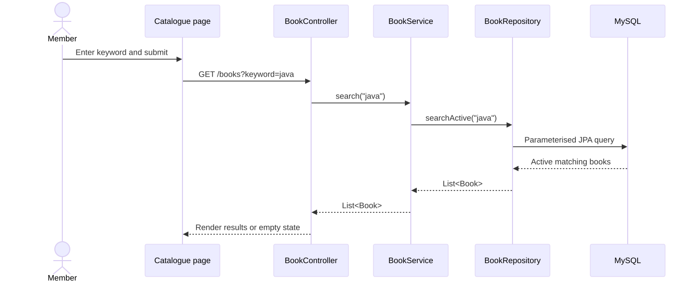

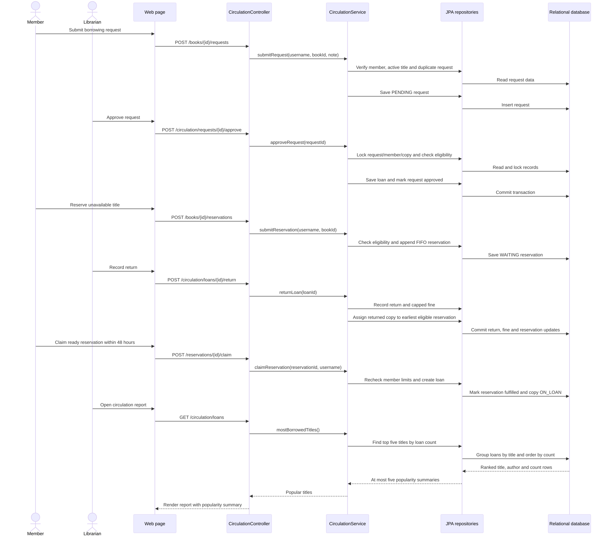

</details>

### 3.2.3 – Database Design


| Bảng | Dữ liệu chính |
| --- | --- |
| `user_accounts` | Tài khoản, vai trò, hạng thành viên và trạng thái hoạt động. |
| `books`, `book_copies` | Thông tin đầu sách và trạng thái từng bản sao vật lý. |
| `borrow_requests` | Yêu cầu mượn theo thành viên và đầu sách, kèm trạng thái xử lý. |
| `loans` | Lượt mượn theo từng bản sao, hạn trả, ngày trả và tiền phạt. |
| `reservations` | Hàng đợi đặt trước và thời hạn giữ bản sao. |
| `fine_settlements` | Các lần ghi nhận thanh toán hoặc miễn phạt cho một lượt mượn. |

`loans.request_id` là khóa ngoại có ràng buộc duy nhất và có thể để trống. Duyệt một yêu cầu tạo tối đa một lượt mượn. Lượt mượn tạo khi thành viên nhận sách đã đặt trước có `request_id` trống.

### 3.2.4 – Interface Design

Khách có thể tìm sách và mở chi tiết mà chưa cần đăng nhập. Sau khi đăng nhập, Member có mục **Hoạt động của tôi**. Librarian có menu quản lý yêu cầu, lượt mượn, đặt trước và thành viên.


[Bản phác thảo các màn hình](docs/design/wireframes.md)

### 3.3.2 – Implemented Functions

| UC | Chức năng và màn hình | Đầu vào | Đầu ra |
| --- | --- | --- | --- |
| UC-01 | Đăng ký, đăng nhập và đăng xuất | Thông tin đăng ký hoặc thông tin đăng nhập | Tài khoản Member mới, phiên đăng nhập hoặc phiên đã kết thúc |
| UC-02 | Quản lý sách và bản sao | Thông tin đầu sách, mã bản sao và trạng thái | Thông tin được lưu hoặc cập nhật. Đầu sách có thể ngừng lưu thông |
| UC-03 | Tìm sách và mở chi tiết | Từ khóa theo tên, tác giả, ISBN hoặc thể loại | Danh sách kết quả, chi tiết sách và số bản sao khả dụng |
| UC-04 | Gửi yêu cầu trên trang chi tiết sách | Đầu sách và ghi chú nếu có | Yêu cầu ở trạng thái `PENDING` |
| UC-05 | Duyệt hoặc từ chối trên trang yêu cầu mượn | Yêu cầu đang chờ và quyết định của thủ thư | Lượt mượn và hạn trả nếu duyệt thành công, hoặc yêu cầu bị từ chối |
| UC-06 | Ghi nhận trả trên trang lượt mượn | Lượt mượn đang mở | Ngày trả, tiền phạt nếu có và trạng thái bản sao mới |
| UC-07 | Xem trang Hoạt động của tôi | Tài khoản Member đang đăng nhập | Yêu cầu, lượt mượn, đặt trước và tiền phạt của chính thành viên |
| UC-08 | Đặt trước trên trang chi tiết sách | Đầu sách chưa có bản sao khả dụng | Đặt trước được ghi vào hàng đợi |
| UC-09 | Quản lý hồ sơ thành viên | Tên hiển thị, hạng và trạng thái tài khoản | Hồ sơ Member đã cập nhật |
| UC-10 | Nhận hoặc hủy trong Hoạt động của tôi | Đặt trước của thành viên và thao tác đã chọn | Lượt mượn mới khi nhận sách, hoặc đặt trước đã hủy |
| UC-11 | Lọc và xử lý phạt trên báo cáo lưu thông | Từ khóa, trạng thái lượt mượn, thao tác thanh toán hoặc miễn phạt và ghi chú | Danh sách đã lọc hoặc giao dịch xử lý phạt được lưu |
| UC-12 | Xem đầu sách được mượn nhiều | Lượt mượn đã ghi trong hệ thống | Tối đa năm đầu sách xếp theo lượt mượn |

Trong [tầng service](src/main/java/com/elibrary/service/), `BookService` và `BookCopyService` quản lý danh mục, `CirculationService` xử lý mượn trả và `MemberManagementService` quản lý hồ sơ thành viên.

**Tìm sách (UC-03).** Kết quả khi nhập `Robert` trong danh mục mẫu.

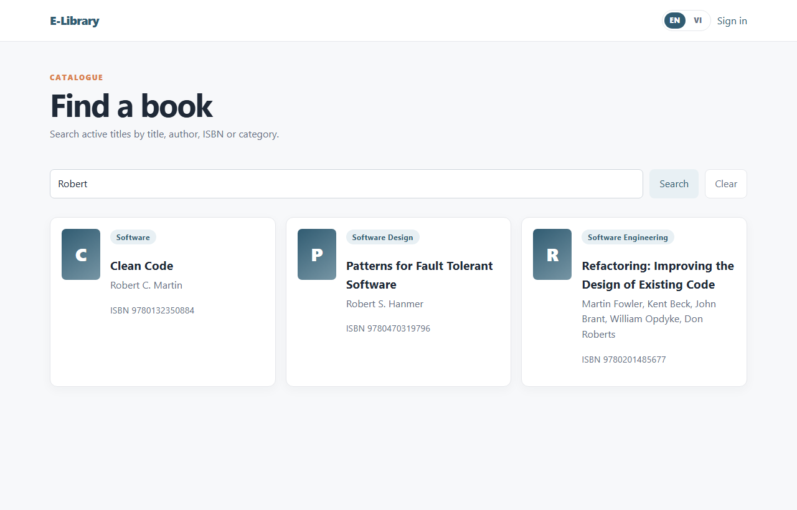

<details>
<summary>Ảnh đăng nhập, đăng ký Member và chi tiết sách</summary>

**Đăng nhập (UC-01)**

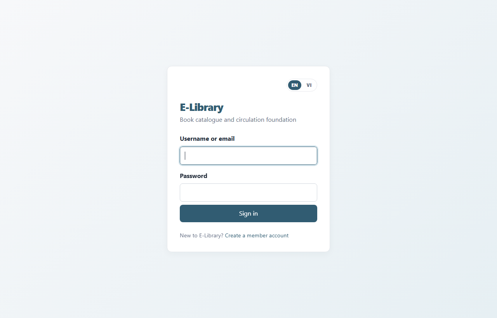

**Đăng ký Member (UC-01)**

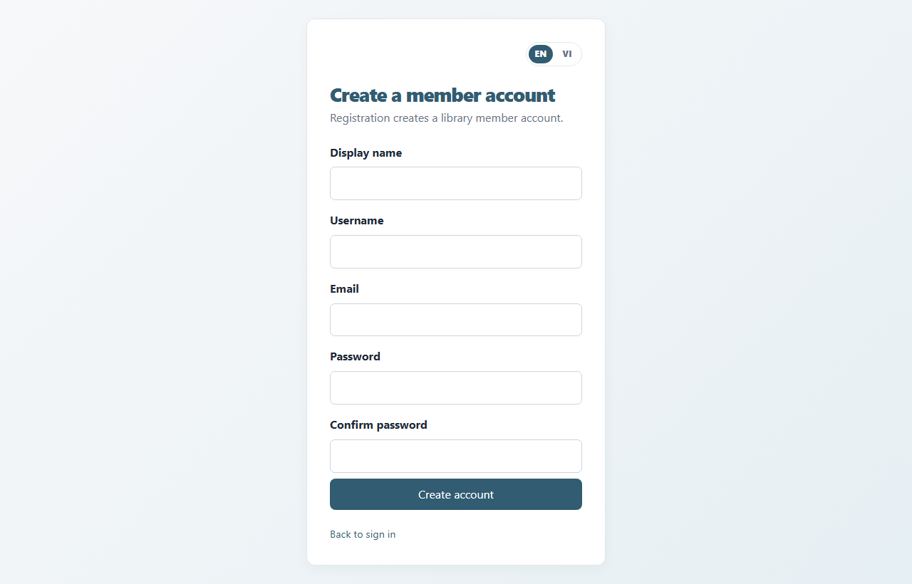

**Chi tiết sách và bản sao (UC-03)**

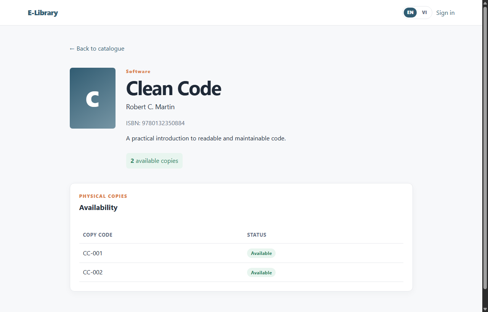

</details>

[Mã Mermaid của các sơ đồ](docs/design/)

## Đối chiếu yêu cầu nhóm hai thành viên

Tài liệu đề tài gợi ý 9–12 UC, 12–16 lớp nghiệp vụ, 4–5 quy tắc và ít nhất 15 ca kiểm thử được ghi nhận. E-Library có **12 UC, 12 kiểu nghiệp vụ (10 class và 2 record), 5 quy tắc và 77 ca kiểm thử** trong tài liệu theo tuần.

## Công nghệ

- Java 17, Spring Boot 3.3, Spring MVC và Thymeleaf.
- Spring Security, Spring Data JPA và Bean Validation.
- MySQL cho môi trường local; PostgreSQL trên Supabase cho cấu hình production.
- Maven, JUnit 5, Mockito và Docker.
- Render dùng để chạy web service; cấu hình triển khai nằm trong `render.yaml`.

## Cấu trúc dự án

### Mã nguồn ứng dụng — `src/main`

| Thư mục / file | Nội dung |
| --- | --- |
| `src/main/java/com/elibrary/config/` | Cấu hình bảo mật, khởi tạo dữ liệu, tài khoản quản trị production và ngôn ngữ giao diện. |
| `src/main/java/com/elibrary/domain/` | Các đối tượng nghiệp vụ như sách, bản sao, tài khoản, lượt mượn, đặt trước và quy tắc tính phạt. |
| `src/main/java/com/elibrary/repository/` | Spring Data repository dùng để truy vấn và lưu dữ liệu. |
| `src/main/java/com/elibrary/service/` | Nghiệp vụ đăng ký thành viên, quản lý sách và xử lý lưu thông. |
| `src/main/java/com/elibrary/web/` | Controller nhận yêu cầu web, xử lý trang lỗi và thông báo giao diện. |
| `src/main/java/com/elibrary/web/form/` | Đối tượng nhận dữ liệu biểu mẫu và kiểm tra dữ liệu nhập. |
| `src/main/resources/templates/auth/` | Trang đăng nhập và đăng ký thành viên. |
| `src/main/resources/templates/books/` | Danh sách, chi tiết và biểu mẫu đầu sách. |
| `src/main/resources/templates/copies/` | Biểu mẫu quản lý bản sao vật lý. |
| `src/main/resources/templates/circulation/` | Trang yêu cầu mượn, lượt mượn, đặt trước và hoạt động thành viên. |
| `src/main/resources/templates/members/` | Trang thủ thư quản lý tài khoản thành viên. |
| `src/main/resources/templates/error/` | Trang lỗi truy cập và lỗi ứng dụng. |
| `src/main/resources/templates/fragments/` | Thành phần giao diện dùng chung, gồm thanh điều hướng. |
| `src/main/resources/static/css/` | CSS của ứng dụng. |
| `src/main/resources/messages.properties`, `messages_vi.properties` | Nhãn giao diện và thông báo tiếng Anh/tiếng Việt. |
| `src/main/resources/application*.properties` | Cấu hình Spring mặc định và profile cơ sở dữ liệu. |

### Kiểm thử — `src/test`

| Thư mục | Nội dung |
| --- | --- |
| `src/test/java/com/elibrary/config/` | Kiểm thử cấu hình và khởi tạo tài khoản. |
| `src/test/java/com/elibrary/domain/` | Kiểm thử quy tắc nghiệp vụ trong domain. |
| `src/test/java/com/elibrary/repository/` | Kiểm thử truy vấn và tìm kiếm dữ liệu. |
| `src/test/java/com/elibrary/service/` | Kiểm thử dịch vụ và luồng nghiệp vụ. |
| `src/test/java/com/elibrary/web/` | Kiểm thử tích hợp controller, phân quyền, biểu mẫu và giao diện. |
| `src/test/resources/` | Cấu hình dùng riêng khi chạy test. |

### Tài liệu — `docs`

| Thư mục / file | Nội dung |
| --- | --- |
| `docs/design/` | Kiến trúc, sơ đồ Mermaid, ảnh SVG dùng trong README và wireframe. |
| `docs/screenshots/` | Ảnh minh họa từ ứng dụng chạy local với dữ liệu mẫu. |
| `docs/use-cases-week*.md` | Use case được chia theo các mốc tuần. |
| `docs/test-cases-week*.md` | Test case và kết quả kiểm tra theo từng mốc. |
| `docs/requirements-week2.md` | Functional requirement, non-functional requirement và BR-01–BR-05. |
| `docs/week*-status.md`, `weekly-progress.md` | Tiến độ và các điểm đã kiểm tra theo tuần. |
| `docs/week9-acceptance.md` | Checklist nghiệm thu trên trình duyệt, database và môi trường triển khai. |
| `docs/deployment-render-supabase.md` | Ghi chú cấu hình Render và Supabase. |
| `docs/sample-catalogue-data.md` | Nguồn và ghi chú về dữ liệu danh mục mẫu. |
| `docs/work-plan-week1-10.md` | Kế hoạch các mốc tuần. |

### File cấu hình ở thư mục gốc

| File | Nội dung |
| --- | --- |
| `pom.xml` | Dependency và cấu hình build/test Maven. |
| `Dockerfile`, `.dockerignore` | Đóng gói ứng dụng và loại file local khỏi Docker build context. |
| `compose.yaml` | Chạy ứng dụng cùng MySQL local có volume lưu dữ liệu. |
| `render.yaml` | Cấu hình Render Blueprint và biến môi trường production. |
| `.env.example` | Mẫu biến môi trường cho local; không chứa thông tin production. |
| `RUN_GUIDE.md` | Hướng dẫn chạy và kiểm tra dự án. |

Thư mục `data/` chứa database H2 local nếu sử dụng profile H2; dữ liệu này không được commit. Thư mục `target/` là kết quả build Maven được tạo lại khi build.

## Chạy local

Cần JDK 17 và Docker Desktop. Tại thư mục dự án, chạy:

```powershell
if (-not (Test-Path .env)) { Copy-Item .env.example .env }
docker compose up --build
```

Mở [http://localhost:8080](http://localhost:8080). Dừng ứng dụng bằng:

```powershell
docker compose down
```

Docker Compose giữ dữ liệu MySQL trong volume để lần chạy sau tiếp tục sử dụng. Hướng dẫn đầy đủ, bao gồm cách chạy không dùng Docker, nằm trong [RUN_GUIDE.md](RUN_GUIDE.md).

## Kiểm thử và trạng thái

Chạy `mvn test` để kiểm thử hoặc `mvn verify` để kiểm thử và đóng gói. Lần chạy đã ghi nhận ngày 8/11/2026 đạt **89/89 test tự động**. Kiểm tra trên trình duyệt và xác nhận dữ liệu trên Supabase còn chờ thực hiện. [Checklist nghiệm thu](docs/week9-acceptance.md)

## Website và repository

| Nội dung | Liên kết |
| --- | --- |
| Website Render | [elibrary-web-gy9e.onrender.com](https://elibrary-web-gy9e.onrender.com) |
| GitHub repository | [261_72ITSE41704_2474802010400_E-Library](https://github.com/trithanh1577/261_72ITSE41704_2474802010400_E-Library) |
| Pull requests | [Danh sách Pull Requests](https://github.com/trithanh1577/261_72ITSE41704_2474802010400_E-Library/pulls) |
| Render Dashboard | [dashboard.render.com](https://dashboard.render.com/) |
| Supabase Dashboard | [supabase.com/dashboard](https://supabase.com/dashboard) |

Trạng thái website và kết nối Supabase cần được xác nhận trên Render Dashboard. Không commit file `.env`, mật khẩu production, chuỗi kết nối có thông tin xác thực hoặc dữ liệu database local lên GitHub.
